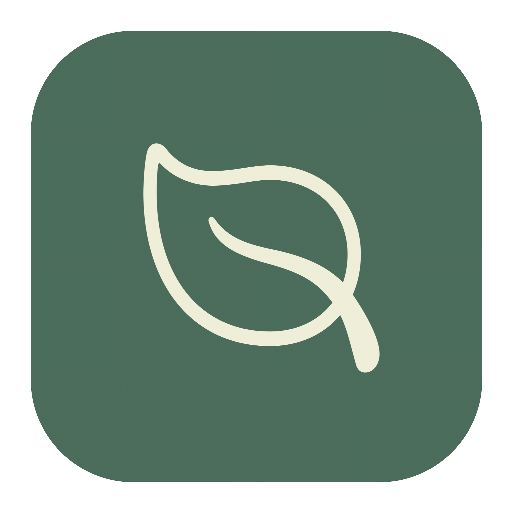
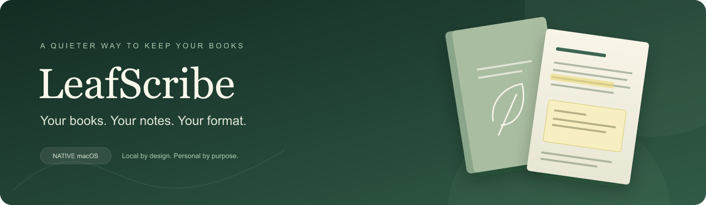

<div align="center">
  
  <h1>LeafScribe</h1>
  <p><strong>Your books. Your notes. Your format.</strong></p>
  <p>A native macOS workspace for turning your own books into useful documents.</p>
  <p>
    <a href="https://github.com/rafaelreverberi/LeafScribe/releases/latest"></a>
    <a href="https://github.com/rafaelreverberi/LeafScribe/actions/workflows/ci.yml"></a>
    
    
    <a href="LICENSE"></a>
  </p>
  <p>
    <a href="https://github.com/rafaelreverberi/LeafScribe/releases/latest"><strong>Download for Mac</strong></a> ·
    <a href="#getting-started">Getting started</a> ·
    <a href="docs/USER_GUIDE.md">User guide</a> ·
    <a href="#building-from-source">Build from source</a>
  </p>
</div>



> [!IMPORTANT]
> **Private, non-commercial use only. Use at your own risk.** LeafScribe’s independently authored code is provided under the [Personal Use License](LICENSE). Use only content you are authorized to access and convert. Private use does not automatically grant copyright permission. Books, covers, and annotations remain protected; this repository and its releases contain no publisher books or user notes. Keep backups and review your exports.

## A small studio for your library

LeafScribe brings downloaded Beook books, EPUBs, HTML documents, and PDFs into one native macOS library. Preview a chapter, choose the sections you need, and export a document you can keep using locally. Your sources stay unchanged.

| Read, organize, and preview | Export with care |
| --- | --- |
| **Beook discovery** — find locally downloaded books and profiles. | **PDF & EPUB** — export supported sources to either format. |
| **EPUB import** — ZIP archives and unpacked Apple Books `.epub` packages. | **Your annotations** — recover Beook highlights and text notes at their source anchors where possible, plus an appendix. |
| **Native previews** — chapter navigation, WebKit reading views, and PDFKit. | **Choose your sections** — export a whole book or selected chapters. |
| **Real cover art** — EPUB 2/3 cover discovery, proportional or stretched covers. | **Searchable PDFs** — text, images, tables, page numbers, and chapter outlines. |
| **A familiar Mac app** — grid/list library, inspector, settings, and export history. | **PDF-to-EPUB & OCR** — extract text, with optional Vision OCR for scans. |

**Local by design.** No account, cloud conversion, analytics, or document upload. Preview and conversion block remote web resources and source JavaScript. The packaged app includes its Python helper; users do not need to install Python.

## Getting started

1. Download **LeafScribe-macOS-arm64.zip** from the [latest release](https://github.com/rafaelreverberi/LeafScribe/releases/latest).
2. Extract it and move **LeafScribe.app** to Applications.
3. Open the app. Downloaded Beook books are discovered automatically; use **Import books** (`⌘O`) for EPUB, HTML, or PDF.
4. Select a book, choose **Preview content** or **Export book** (`⌘E`), then select a format, sections, and destination.

> [!NOTE]
> **Early release · Apple Silicon · macOS 14+.** The distributed app is ad-hoc signed and **not Apple-notarized**. macOS may block the first launch. Inspect the source and release details before choosing whether to allow it through macOS Privacy & Security. This is not an App Store or Developer ID release. Intel builds and macOS 14 hardware have not been validated.

**Cover preference:** Settings → General → Cover display → **Fit proportionally** or **Stretch to fill**. The choice applies immediately and is saved.

## Formats at a glance

| Input | Export to PDF | Export to EPUB |
| --- | --- | --- |
| **Beook** | Fixed canvases or paginated reading layout; optional highlights, notes, appendix, and section outline | Reconstructed EPUB with optional annotations and selected sections |
| **EPUB** | Spine order with local styles, images, and chapter pagination | Whole package copied unchanged; selected chapters repackaged |
| **HTML** | Paginated document with local images, styles, and tables | Normalized XHTML and local assets |
| **PDF** | Original bytes preserved, including native annotations | Text extraction; optional OCR when a text layer is absent |

## Know what to expect

- **Content rights come first.** LeafScribe does not provide books, grant content licenses, bypass authentication, or remove DRM. Encrypted EPUB resources, including obfuscated fonts, are rejected.
- **Conversions need review.** Source styles, complex layouts, and publisher-specific structures can affect pagination. Interactive Beook exercises become static. Paper output is not a pixel-identical copy of an app screen.
- **Annotation recovery is explicit.** Valid stored text ranges retain highlight colors. Text notes follow their paragraph anchors. Empty, stale, or ambiguous positions remain in the appendix rather than being placed at a guessed location. PDF highlights are rendered marks, not editable native highlight annotations.
- **OCR is text-first.** PDF-to-EPUB does not reconstruct page layouts or images. Review recognition results before relying on them.
- **Sources stay intact.** Imports create managed copies; databases are read-only. Completed exports are staged before replacing a destination. No partial destination is committed on failure or cancellation.

More details: [user guide](docs/USER_GUIDE.md) · [validation and tested boundaries](docs/VALIDATION.md) · [architecture](docs/ARCHITECTURE.md).

## Building from source

Requires Swift 6 / Xcode command line tools, Python 3.12, and [uv](https://docs.astral.sh/uv/). Build on the target CPU architecture.

```sh
git clone https://github.com/rafaelreverberi/LeafScribe.git
cd LeafScribe
Scripts/build_app.sh
open dist/LeafScribe.app
```

The build freezes the helper, assembles resources and license notices, generates the icon, and ad-hoc signs the bundle. Nothing is uploaded by the build script.

```sh
swift test
python3 -m unittest discover -s Tests/Engine -v
python3 Scripts/test_upstream.py
Scripts/verify_bundle.sh
```

Bundle verification needs a logged-in graphical macOS session. `python3 Scripts/verify_live.py` is separately opt-in, reads installed Beook books, and reports aggregate results only. CI uses original fixtures; user books are never required for portable tests.

## Under the leaves

```text
SwiftUI library & settings
          ↓
Swift core · versioned JSON interface
          ↓
LeafScribe Python adapters + pinned beook-export core
          ↓
WebKit pagination · PDFKit assembly · Vision OCR
```

The macOS renderer and portable extraction helper have separate responsibilities. Source-specific adaptations live in `Engine/leafscribe`; vendored upstream modules remain unchanged.

## License, credit, and responsible use

LeafScribe is **source-available for private, non-commercial use**, not OSI open source. Read the [Personal Use License](LICENSE) before use or redistribution. The software is supplied **as is, without warranty**, to the extent permitted by law. You are responsible for checking content permissions, applicable law, and the accuracy of converted files. No guarantee is made that a particular conversion is legally permitted or that every publisher format will work.

LeafScribe reuses **[beook-export by JoGe07](https://github.com/JoGe07/beook-export)**, © 2026 JoGe07, under its **MIT license**. Its discovery, database access, extraction, resource reconstruction, and EPUB writer are preserved at the [pinned upstream revision](Engine/vendor/UPSTREAM_REVISION). Those components retain their original permissions; LeafScribe’s personal-use restrictions do not replace their licenses.

The native app, document adapters, JSON interface, and packaging are independently implemented. Runtime licenses and full attribution are included in [THIRD_PARTY_NOTICES.md](THIRD_PARTY_NOTICES.md), [Licenses/](Licenses/), and the app’s About screen. The original sample document is CC0.

**Independent and unaffiliated.** LeafScribe is not associated with Beook, its developers, Apple, or any publisher. All product names and content remain the property of their respective rights holders.

---

<div align="center">
  <sub>Built for the documents you are allowed to keep. Designed to stay on your Mac.</sub>
</div>
